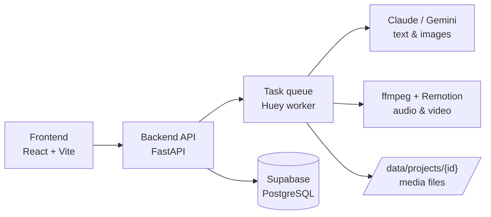

# Basqasha — AI pipeline from idea to animated Kazakh video

Basqasha is a local web app that turns a trending topic into an original, fully animated YouTube video in Kazakh. You give it a link to a popular video for inspiration. AI agents then pick an angle, research and fact-check it, and write an **original** Kazakh script. After you record the voice-over, the app renders a finished MP4 with a character, backgrounds, subtitles and sound effects.

The source video is used only as inspiration: an originality check makes sure the script is not a translation or retelling of the original.

> 🇷🇺 Russian user guide: [docs/README.ru.md](docs/README.ru.md)

## Key features

- **11-step pipeline with a human in the loop** — the system runs each step automatically and pauses only where a human decision matters: choosing the angle, approving the script, uploading the voice-over and approving the preview.
- **Fact-checking with sources** — an AI step searches the web, attaches links to every fact and flags facts it could not confirm.
- **Originality guard** — only the first two steps see the source transcript. The script is written from a brief and verified facts, then checked by an LLM judge and rewritten if it looks like a translation.
- **Automated video rendering** — Remotion builds the video from a JSON storyboard: ~5-second scenes, each with a background, a character pose, captions and sound effects. Loudness is normalised for YouTube.
- **AI-generated backgrounds** — Gemini generates images in the channel's style. A manual mode exports prompts for Google Flow instead.
- **YouTube packaging** — 5 title options, description, chapters and thumbnail prompts, based on an analysis of competitor videos.
- **Growth agent** — analyses successful videos and channels, builds a playbook, and feeds its lessons back into the idea, script and metadata prompts.
- **Cost control** — per-project and monthly budgets, with every AI call's cost tracked in the database.

## Architecture



- **Frontend** shows each project's pipeline, logs and approval screens.
- **Backend** exposes a REST API (OpenAPI spec in `docs/api/`) and queues pipeline steps.
- **Worker** runs the steps in the background. Each step has a state machine: `pending → running → done | waiting_operator | failed`. When a step's output changes, every later step is marked `stale`, and re-running a step creates a new version without deleting old files.
- **Database** stores projects, texts, statuses and costs only; all media stays on local disk.
- **Contracts** between steps are defined as JSON Schemas in `schemas/`, each with an example.

More detail: [docs/ARCHITECTURE.md](docs/ARCHITECTURE.md).

## Pipeline

| # | Step | What the system does | Human action |
|---|---|---|---|
| 1 | Source | Downloads the video's subtitles (yt-dlp) | Paste a link |
| 2 | Idea | Proposes angles for an original video | Pick an angle |
| 3 | Facts | Researches facts with source links | Review flagged facts |
| 4 | Script | Writes a Kazakh script and runs the originality check | Edit and approve |
| 5 | Voice | Prepares the text for text-to-speech | Upload the voice-over MP3 |
| 6 | Storyboard | Splits the script into ~5 s scenes: background, pose, captions, sounds | — |
| 7 | Images | Generates backgrounds with Gemini (or exports prompts) | — |
| 8 | Preview | Builds a contact sheet with a frame of each scene | Comment or approve |
| 9 | Render | Renders the final MP4 with Remotion | Download |
| 10 | Metadata | Writes titles, description, chapters and thumbnail prompts | Publish |
| 11 | Recommendations | Suggests new poses, sounds and music for the library | Add to library |

## Tech stack

| Area | Technologies |
|---|---|
| Frontend | React 19, TypeScript, Vite, Tailwind CSS, TanStack Query |
| Backend | Python 3.12, FastAPI, SQLAlchemy, Pydantic, Huey |
| Database | Supabase (PostgreSQL), SQL migrations |
| AI | Claude (Claude Code CLI), Google Gemini API (text, images, embeddings) |
| Video & audio | Remotion (React), ffmpeg, yt-dlp |
| Tooling | uv, PowerShell / Bash dev scripts, Claude Code agents for AI-assisted development |

## Getting started

**Requirements:** Python 3.12 with [uv](https://docs.astral.sh/uv/), Node.js, ffmpeg, a Supabase project, a Gemini API key and (optionally) the Claude Code CLI.

```bash
git clone https://github.com/yedilmyrzabek-wq/Basqasha.git
cd Basqasha
cp .env.example .env        # fill in DATABASE_URL and GEMINI_API_KEY
```

Start the API, the worker and the frontend together:

```bash
# Windows
powershell -ExecutionPolicy Bypass -File scripts\dev.ps1

# macOS / Linux
./scripts/dev.sh
```

Then open http://localhost:5173. The dev script restarts any process that crashes.

## Project structure

```
backend/      FastAPI app, pipeline steps, AI modules (backend/ai)
frontend/     React UI
engine/       Remotion video compositions and render scripts
prompts/      Versioned prompt templates (Markdown)
schemas/      JSON Schemas for data passed between steps
supabase/     Database migrations
library/      Character poses, style samples, sound effects
docs/         Brief, plan, architecture, API spec, research
scripts/      Dev and utility scripts
```

## Status

A personal project in active development, used to produce videos for a Kazakh-language YouTube channel. The sound effects in `library/sfx/` are temporary placeholders.

## Author

**Yedil Myrzabek** — [GitHub](https://github.com/yedilmyrzabek-wq) · yedilmyrzabek@gmail.com
